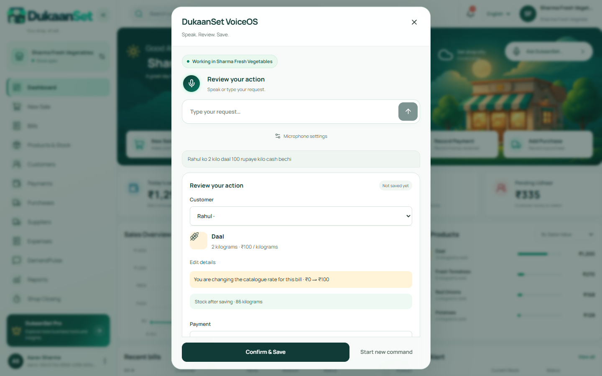
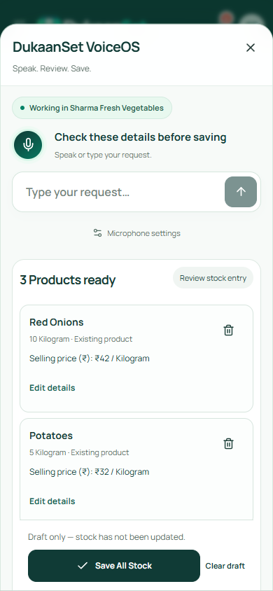
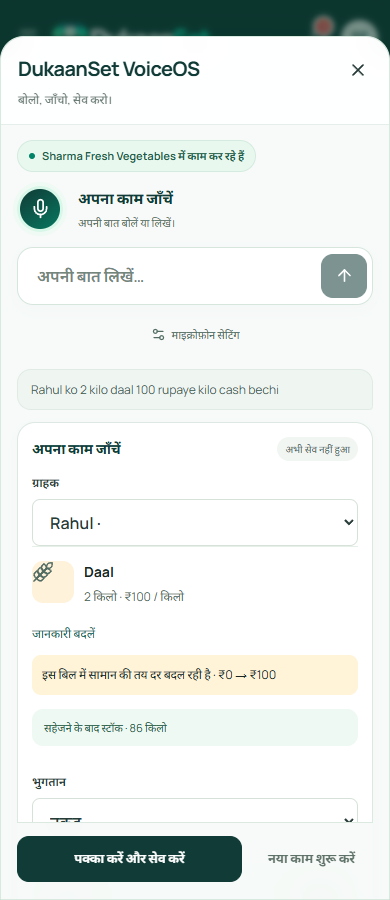

# V17.1 Global VoiceOS verification

VoiceOS now keeps the current business task through short follow-ups, corrections and incidental reads. It uses one global speech/text composer, asks for missing details, shows editable domain previews and saves only after confirmation. Successful stock retries release the next task; uncertain writes keep their original payload and idempotency key.

## Implemented behavior

| Workflow | Actual service and behavior |
| --- | --- |
| Sales | Existing voice-sale transaction; separate customer/product roles, unit-rate conversion, cash/UPI/credit/split, exact paise totals, one stock deduction and ledger update |
| Products | Existing catalogue import; explicit name/unit/price, zero opening stock for product-only creation, transaction-level duplicate guard |
| Stock | Existing atomic stock batch; existing/new products, explicit selling and purchase amounts, edited-row context, targeted corrections, one Save All Stock and frozen retry |
| Customers, collections, expenses | Existing contact/payment/expense services; editable previews and actual confirmed results |
| Suppliers, purchases, demand | Existing confirmed domain forms; scoped voice handoff rather than a second financial engine |
| Reports and navigation | Authoritative reports, scoped record resolution, immediate permitted navigation; unfinished task can be resumed |
| Documents and WhatsApp | Existing saved-source document studio and delivery preview; sharing keeps recipient confirmation and actual delivery semantics |
| Closing and corrections | Current trading-session summary is read-only; closing, refunds, reversals and write-offs use their existing stronger record reviews |
| Business intelligence | Existing insights, reorder planner, invoice extraction and simulator; draft orders are separate from receiving goods |

An ambiguous customer “add” request asks bill or stock. A generic “best product” asks whether a named product should be created or a recommendation is wanted. Corrections replace one unambiguous role or row; uncertain targets remain blocked. Prices, payment methods and unknown product details are never silently filled with invented values.

## Optional structured understanding

Configured OpenAI understanding is opt-in. Its bounded request contains the merchant's command, recent instructions and a projection of the current task/selected record. It sends no raw audio, identifiers, full catalogue or ledger dump. The response supplies semantic slots only; the existing resolvers, permissions, amount/unit checks and domain transactions remain authoritative. Strict output schema, refusal handling, timeout, cancellation and request generations prevent stale results from overwriting edits. One merchant confirmation reviews and saves a normal complete draft.

This follows the official [Structured Outputs guide](https://developers.openai.com/api/docs/guides/structured-outputs) and [conversation-state guide](https://developers.openai.com/api/docs/guides/conversation-state). Availability reports configuration, not a successful live provider test. Financial record corrections are excluded from model interpretation and routed to saved-record review.

## Checks

- 298 unit/backend tests pass, including 34 V17 semantic/transaction/recovery tests and 5 mocked-provider boundary tests.
- The combined labelled corpus passes 66 intent cases and 188 slot checks. Parse timings cover 1,650 repetitions; this small fictional corpus does not estimate real-world acoustic or semantic accuracy. See [evaluation.json](evaluation.json).
- 58 browser tests pass across V17, conversation, V15, V14, contextual heroes, product/stock, legacy speech, invoices and closing suites. They inspect actual backend records and include lost acknowledgements, exact-once retries, tenant/role boundaries and provider cancellation.
- Browser speech tests simulate the recognition API and pass final transcripts through the real backend. Interim-only input never saves. Denied microphone use retains typing. Live acoustic transcription and a live OpenAI service have not been verified.
- Typecheck, source lint, production build and all 2,426 localization keys pass; no hardcoded visible text is reported.
- Desktop/mobile checks cover English, Hindi and Hinglish at 320, 360, 375, 390, 412, 430, 768, 1024, 1280, 1440 and 1920px. Draft/stock states receive additional viewport and WCAG A/AA checks. The phone stock confirmation remains visible before scrolling.
- Compiled production review runs on its own local server/database, verifies real sales/collections/catalogue/stock, actual closing totals and saved-document selection, and performs nine multilingual draft accessibility scans. See [production-report.json](production-report.json).

Dates use the active business timezone and cutoff. Model names, customer names and raw financial values are absent from development diagnostic events; bounded diagnostic summaries report state/count/latency only. No new external analytics collection was added.

## Deployment status

The existing dev staging root and health URL redirect to Vercel sign-in (HTTP 302). [hosted-staging.json](hosted-staging.json) records the check. These local checks do not establish a healthy hosted staging release, physical microphone compatibility, actual WhatsApp delivery or configured live AI. Production promotion remains subject to the existing release gates.

## Visual evidence

