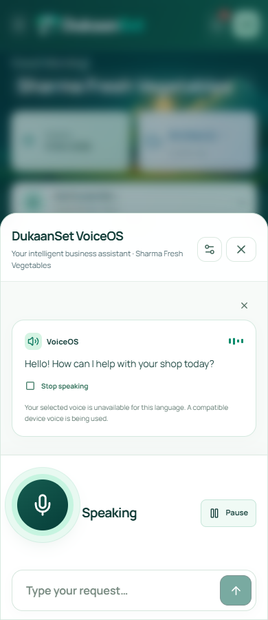
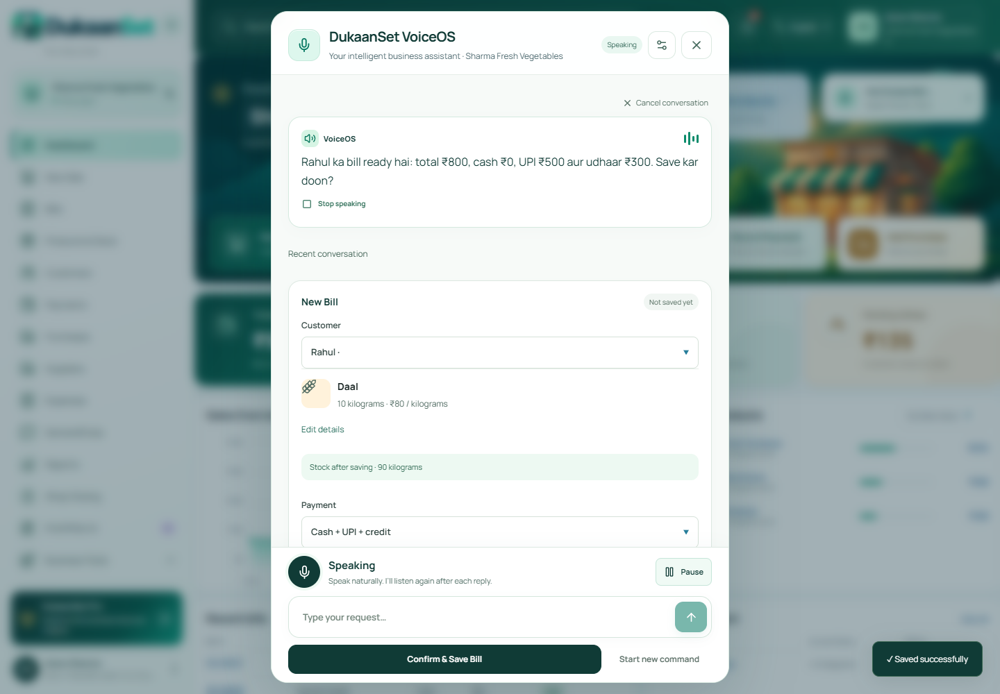

# VoiceOS 3.3 QA — 2026-10-13

The automated implementation is ready for review. Production speech acceptance is **pending**. No human microphone or live provider result is represented as a passing automated test.

## Scope and cause

The old provider opened in Quick Mode, with automatic follow-up disabled until a manual microphone action. Duplicate-customer replies stopped turn-taking, the draft UI blocked any matching name, and the request builder always rejected it. VoiceOS now opens into a session-controlled hands-free loop, resolves the outstanding duplicate question before fresh routing and accepts an explicitly separate same-name customer while retaining phone protection.

Pause stays latched until Resume. Close, backgrounding and account/shop changes release audio. Old recognition callbacks and late read results cannot update a new turn. New commands can replace a fetching report; reopening clears finished read-only answers while preserving an unfinished draft. Exact frozen requests recover committed backend receipts before retrying, and a failed receipt read cannot cause another mutation.

The assistant layout keeps its composer and confirmation outside the scrolling conversation. The approved dashboard, sidebar and application header layouts were preserved. Genuine device/provider voices and authenticated preferences remain in the header picker and Main Settings.

## Environment

Windows, Node.js 24.18.0, Next.js 16.4.0 and headless Edge/Chromium. Tests used an isolated checkout and fresh fictional SQLite shops on ports 3001/3002. The user's port 3000 preview and business database were not used for these test mutations. Basis: `b4e9225baa6c510a3f60b986e5a28c45c437c3f2`, with the VoiceOS 3.3 working changes on `feature/voiceos-3`.

## Results

| Check | Result | Evidence boundary |
| --- | --- | --- |
| Complete unit/backend suite | 323 passed | Real domain services, validation, permission/tenant checks, transactions, idempotency and audio contracts; provider transport stubbed where needed |
| New VoiceOS 3.3 browser suite | 7 passed | Default greeting/listening cycle, separate Rahul, delayed authenticated readback, one POST, pause/close, permission fallback, receipt recovery, fresh reopen and layouts |
| VoiceOS 3.1 regression | 9 passed | Native final callbacks simulated; actual encoded MediaRecorder audio with synthetic input; 1.2-second pause retained within the utterance |
| VoiceOS 3 regression | 7 passed | Real synthetic audio encoding/playback, confirmed customer/bill/stock, persisted preference and language/scope behavior |
| V17 regression | 5 passed | Actual corrections, billing/payment/product records, frozen stock recovery, interpretation races and multilingual accessibility |
| Conversational regression | 6 passed | Combined customer/sale, atomic new stock product, concurrent catalogue changes and keyboard/mobile controls |
| Premium V14 regression | 7 passed | Cross-module reviewed forms, DemandPulse, shared assistant and domain editors |
| Approved dashboard regression | 4 passed | Exact metrics, chart/search, media reuse, ledger preservation and desktop/phone modules |
| Legacy VoiceOS regression | 8 passed | Billing/collection/stock/demand/forms, uncertain acknowledgements, capture cleanup and language layouts |
| Browser total | 53 passed | Automated browser cases; no physical Android device |
| Lint / types / locale parity | Passed | 183 source files; 2,628 locale keys with matching variables across English, Hindi and Hinglish |
| Production build | Passed | Isolated optimized application build |
| Compiled browser review | Passed | 8 checks, 30 layouts and 18 Axe scans with no reported WCAG A/AA violation, runtime exception or CSP violation |
| Live acceptance gate with pending record | Correctly fails | Main promotion cannot proceed from the unfilled acceptance record |

The labelled typed evaluation passed 66/66 intents and 188/188 checked slots. The separate language/control evaluation passed 24 language cases and 9 controls. These are small text corpora; they do not establish real transcription accuracy, spoken latency or pronunciation quality.

[Duplicate flow evidence](duplicate.json) records zero manual microphone clicks, one actual customer POST, distinct Rahul IDs and readback-gated success. ASR and TTS events in that case are simulated. [Layout evidence](layouts.json) records 12 new-dialog layouts and 3 Axe scans. [Compiled evidence](production-report.json) records the separate 30-layout/18-scan review and its audio limitations.

An immediate launcher count after reload was changed to wait for hydration. The compiled audio-failure regression was updated to observe the automatic greeting failure, instead of adding a manual replay and expecting the old request count. Both corrected regressions pass; no application behavior was weakened to satisfy those assertions.

## Visual review

Compiled phone greeting, optional typing and Pause control:

Compiled editable bill and persistent confirmation:

Hindi/Hinglish phone captures and the voice picker are also included in this folder. The picker fixture uses simulated device voice metadata; its screenshots do not certify availability of those fixture voices on a real device.

## Pending production acceptance

The owner has confirmed access to desktop/Android testing and available credentials. The local configuration audit found no configured OpenAI STT or Azure TTS secrets. The server-side environment location or HTTPS staging URL has not yet been supplied, and no real speech run has been recorded.

Endpoint/noise handling, natural pronunciation, genuine multilingual voice capability, physical Android lifecycle and live p95 latency remain unverified. The energy endpoint detector is not a validated neural VAD. Existing supplier, purchase, demand, document and closing actions still use their reviewed forms; this change does not certify spoken completion of every form-based workflow.

Follow [the live checklist](LIVE-TEST.md), record dated human results in [live-acceptance.json](live-acceptance.json), then run `node scripts/qa/voice33-release-gate.mjs`. Feature-to-dev CI and reviewer approval are separate gates. Do not promote to main or claim VoiceOS production-complete while these checks remain pending.
